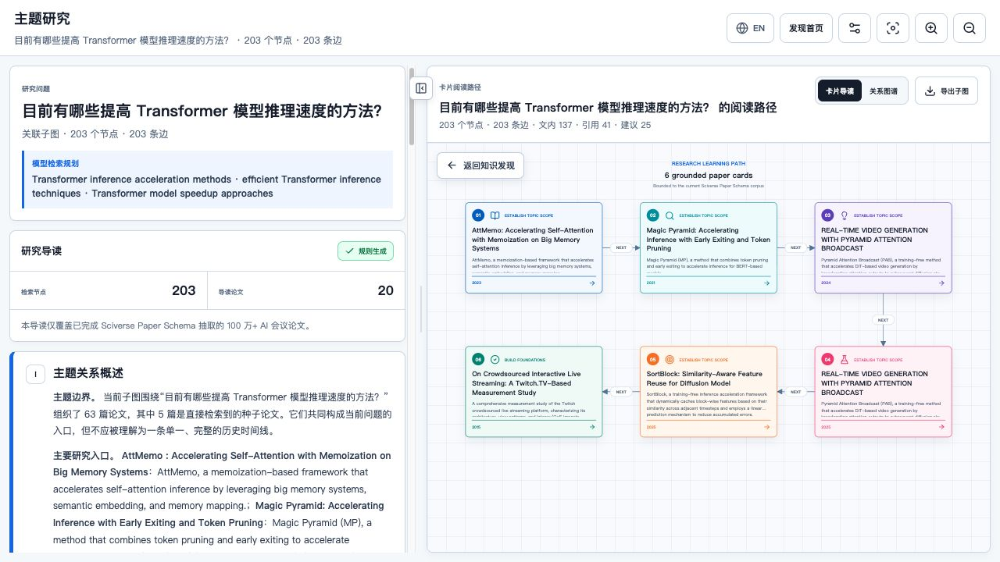
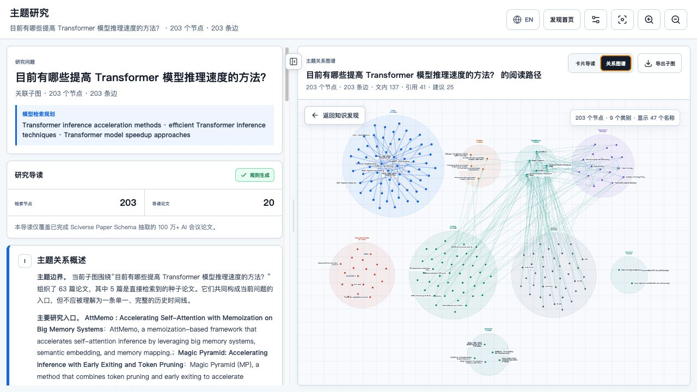
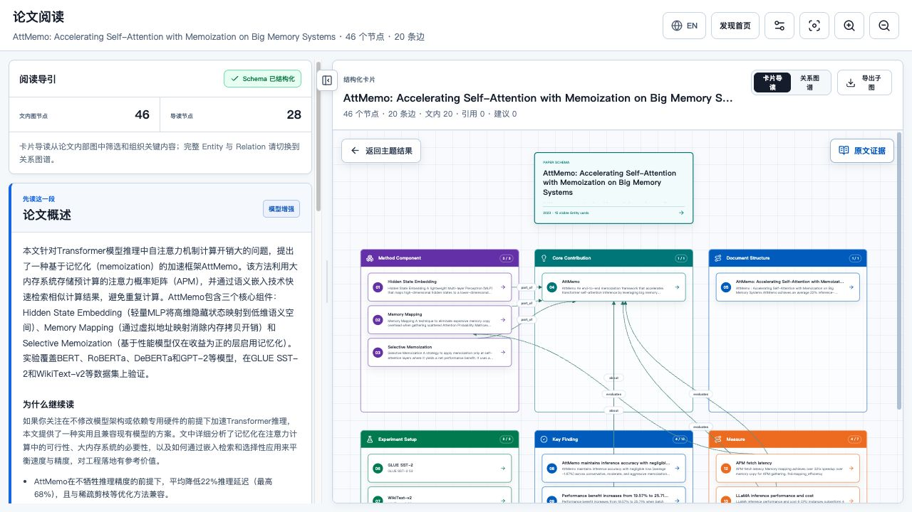

# FrontierLens

FrontierLens is a local AI research reader powered by the public Sciverse Paper
Schema API. It helps a reader discover papers, follow a guided reading path,
inspect extracted entities and relations, traverse resolved citations, and
return structured evidence to the source text.

The application runs locally with a Python backend and a React frontend.

## Product tour

### Build a topic study

Ask a research question to retrieve seed papers, expand their extracted
structure, and generate a grounded reading path. The guide is based on Paper
Schema entities and relations rather than sending complete papers to the
optional model.



### Inspect the relationship graph

Switch to the graph view to compare paper nodes, extracted entity categories,
paper-internal relations, and resolved paper-to-paper citations within the same
bounded topic.



### Open a paper's extracted structure

Each paper opens with a concise overview and a card-based knowledge structure.
Entity groups and relation lines expose methods, contributions, experimental
setups, findings, measures, and document structure without requiring the reader
to scan the full paper first.



### Trace an entity back to the paper

Selecting an entity opens the ordered paper text, jumps to its provenance
location, and highlights the supporting paragraph. DOI and arXiv links remain
available when the metadata provides them.


Screenshots show live Sciverse results captured from a locally running
FrontierLens instance. Results may change as the Paper Schema corpus evolves.

## What it does

- Builds a bounded topic graph from keyword seed papers.
- Enriches seed papers with a balanced, bounded set of extracted Entity nodes
  and internal Relations, rendered in data-driven semantic clusters.
- Keeps paper-internal Entity relations separate from paper-to-paper citations.
- Shows the complete reference list, including unresolved references.
- Opens resolved citation targets by `schema_id`.
- Loads a complete paper-scoped Entity and Relation graph on demand.
- Reads paper text in ordered paragraph batches through the public provenance
  contract, without direct OpenSearch access or local paper storage.
- Searches high-value Evidence and traces Entity/Evidence selections back to
  exact source paragraphs, with a labeled paper-local fallback when no anchor
  exists.
- Uses a clearly labeled, title- and author-verified related publication
  version when the selected formal publication has no paragraph rows.
- Shows real, cancellable progress for topic exploration and paper opening.
- Provides adjustable and collapsible paper-guide and source-reader panes.
- Produces a deterministic reading guide grounded only in graph paper IDs.
- Optionally rewrites Chinese or long-form questions into concise English
  retrieval phrases with a locally configured OpenAI-compatible model.
- Optionally produces a grounded research guide using only paper IDs already
  returned by Sciverse.
- Switches the interface and generated Guide/Roadmap between Chinese and
  English while retaining source paper, Entity, Evidence, and provenance text.
- Preserves the FrontierLens three-state journey:
  - discovery map and research-question entry;
  - Research Guide with Learning Roadmap / Knowledge Subgraph;
  - Paper Reading Guide with Knowledge Structure / Paper Internal Graph.

The visible corpus scope is the current 1M+ AI conference papers with completed
Paper Schema extraction. An empty result never means that the work is absent
from the full scholarly literature.

## Boundary

- This is a standalone source tree with no dependency on ScholarWeave at
  runtime.
- The backend calls `https://api.sciverse.space/paper-schema/*`.
- The browser calls only this project's `/api/*` backend.
- The Sciverse key remains in the local backend.
- No OpenSearch, S3, SQLite graph, internal index name, or raw audit endpoint is
  used.
- No paper, Entity, Relation, Citation, Evidence, or graph data is read from a
  local folder. There is no fixture or demo-data runtime mode.

## Requirements

- Python 3.11 or newer
- [uv](https://docs.astral.sh/uv/)
- Node.js 22 or newer
- npm
- A Sciverse API key
- An OpenAI-compatible model endpoint is optional

## Install and run

```bash
git clone https://github.com/opendatalab/sciverse-frontier-lens.git
cd sciverse-frontier-lens

make setup
```

Start the backend:

```bash
make backend
```

In a second terminal, start the frontend:

```bash
make frontend
```

Open [http://127.0.0.1:3040](http://127.0.0.1:3040).

A fresh installation starts unconfigured and shows no research data. Open
**Connection settings**, enter the Sciverse API Base URL and key, then use
**Test online API** before saving. Once connected, all papers and graph facts
are fetched from the live Sciverse API.

**No `.env` file is required for normal use.** Configure the Sciverse
connection and the optional model connection entirely from the web settings
page.

The Sciverse and optional model connections are managed from the same page and
stored together as plaintext in `local.config.json` in the directory where
FrontierLens is started. The file is ignored by Git and written with owner-only
permissions on supported systems. It contains credentials and connection
settings only, never papers or graph data. Without a model, English keyword
search works normally and a small Chinese AI glossary provides a limited
fallback.

OpenAI-compatible model endpoints may use HTTP or HTTPS in this standalone
local application. Prefer HTTPS because plain HTTP does not encrypt the model
secret or prompts in transit.

## Optional environment configuration

Environment variables are only an optional interface for scripted, headless,
development, or managed startup. Normal local users should use the web settings
page and can skip this section. To provide startup defaults, create `.env` from
`.env.example`:

```dotenv
SCIVERSE_API_TOKEN=<server-side token>
```

`.env` is ignored by Git. Do not put the token in frontend environment
variables, URLs, screenshots, logs, or committed files.

The Sciverse key and optional model secret are separate credentials. Both may
be configured from Local Settings; environment variables are startup defaults.

Run the read-only production check:

```bash
make prod-smoke
```

See [docs/USER_GUIDE.md](docs/USER_GUIDE.md) for the complete workflow.

## Verification

```bash
make setup
make lint
make test
make build
npm --prefix frontend audit --omit=dev --audit-level=high
```

## Documentation

Detailed contracts and operations are documented in
[docs/API_AND_OPERATIONS.md](docs/API_AND_OPERATIONS.md). Architecture decisions
are in [docs/ARCHITECTURE.md](docs/ARCHITECTURE.md).
The verified data and model boundary is recorded in
[docs/DATA_SUPPORT_AUDIT.md](docs/DATA_SUPPORT_AUDIT.md).

Security reports should follow [SECURITY.md](SECURITY.md). Contributions are
described in [CONTRIBUTING.md](CONTRIBUTING.md).

## License

Apache License 2.0. See [LICENSE](LICENSE).
