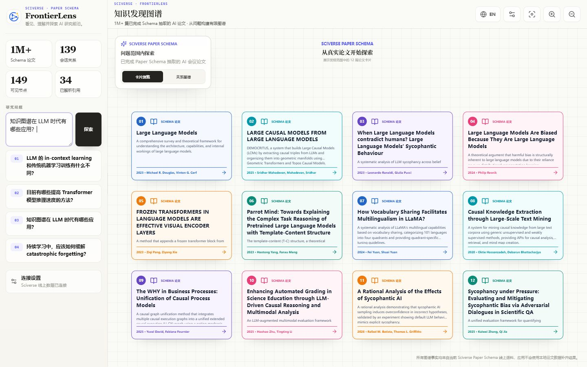
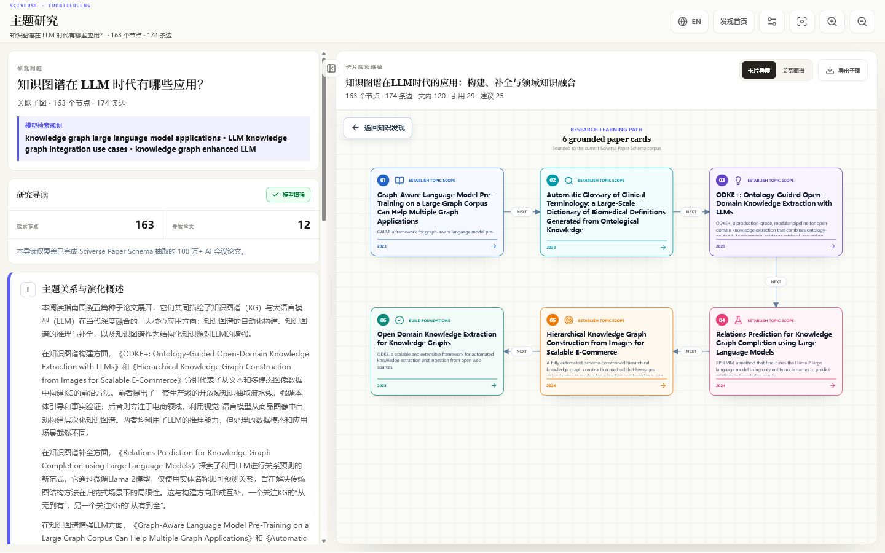
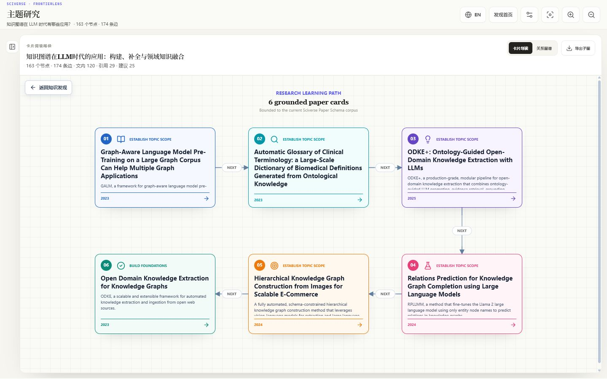
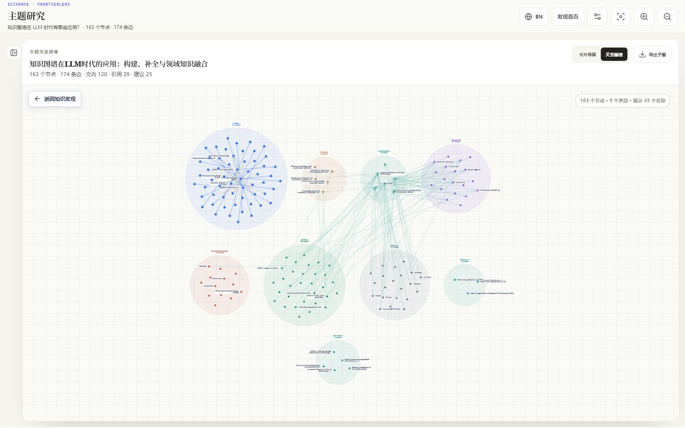
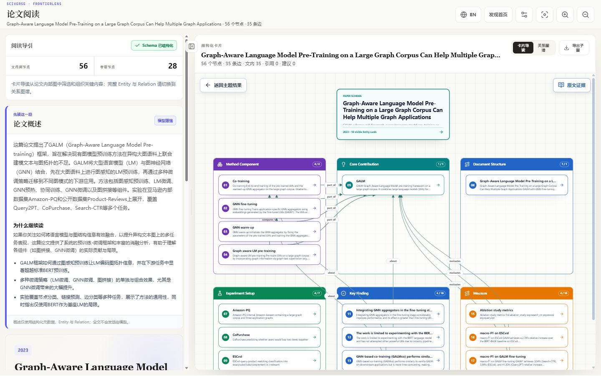
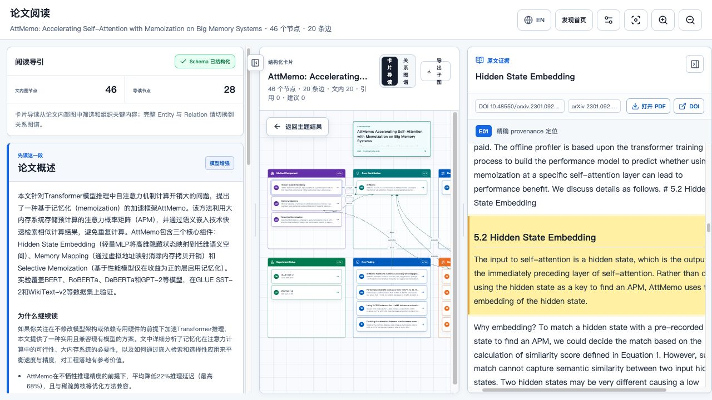

# FrontierLens

[English](README.md) | **简体中文**

FrontierLens 是一款本地运行的 AI 科研阅读应用，由 Sciverse Paper Schema
公开 API 提供数据。它帮助研究者发现论文、沿导读路径阅读、检查抽取出的
Entity 与 Relation、浏览已解析引用，并将结构化 Evidence 回溯到原文。

应用由 Python 后端和 React 前端组成，均在本地运行。

## 产品导览

### 1. 选择研究问题

从一个自然语言研究问题开始，也可以直接选择预置问题。FrontierLens
将问题转换为有限的检索范围，并以 Sciverse Paper Schema 在线语料作为可信数据基础。



### 2. 进入研究工作流

系统自动规划检索词、查找种子论文、扩展论文结构信息、组装主题图谱并生成研究导读。
必需的导读模型只接收结构化的 Paper Schema 材料，不会接收完整论文。



### 3. 浏览论文卡片阅读路径

论文不再只是扁平的搜索结果列表。卡片按照阅读顺序组织标题、贡献与简要背景，
帮助研究者快速建立领域脉络，并决定下一篇需要深入阅读的论文。



### 4. 查看图谱网络

切换到图谱视图，即可在同一个有限主题内比较论文节点、抽取出的 Entity 类别、
论文内部 Relation、已解析的论文间引用，以及带有解释的相关论文建议。



### 5. 展开论文并继续关联学习

进入单篇论文后，可同时查看结构化概述与卡片式知识结构。方法组件、核心贡献、
实验设置、关键发现、指标和文档结构无需通读全文即可展开。除单篇论文导读外，
还能沿已解析引用与相关论文关系连接其他论文拓扑，完成系统性的关联学习。



### 6. 将结构化知识回溯到原文

选择 Entity 或 Evidence 后，系统会打开按顺序组织的论文文本，跳转到来源位置并
高亮支撑段落。元数据提供 DOI 或 arXiv 标识时，界面也会保留对应入口。



所有截图均来自本地运行的 FrontierLens，并使用 Sciverse 在线结果。随着
Paper Schema 语料持续更新，实际结果可能发生变化。

## 功能

- 从关键词种子论文构建范围受限的主题图谱。
- 为种子论文补充均衡且数量受限的 Entity 节点和论文内部 Relation，并按数据中的
  语义类别聚类展示。
- 区分论文内部 Entity 关系与论文之间的引用关系。
- 展示完整参考文献列表，包括尚未解析的引用。
- 通过 `schema_id` 打开已解析的引用论文。
- 按需加载单篇论文完整的 Entity 与 Relation 图谱。
- 通过公开 provenance API 分批读取按顺序组织的论文段落，不直接访问 OpenSearch，
  也不在本地保存论文。
- 搜索高价值 Evidence，并将 Entity 或 Evidence 精确回溯到来源段落；没有锚点时，
  使用带明确标记的论文内回退方式。
- 当选中的正式出版版本没有正文段落时，可使用经过标题与作者校验并明确标记的相关版本。
- 在主题探索和论文打开过程中展示真实、可取消的进度。
- 提供可调节、可折叠的论文导读和原文阅读面板。
- 使用本地配置的 OpenAI 兼容模型，将研究问题改写为简洁英文检索词。
- 使用模型生成研究导读，但只允许使用 Sciverse 已经返回的论文 ID。
- 模型请求失败时明确终止当前任务并返回错误，不生成规则降级结果。
- 支持中英文界面以及中英文 Guide/Roadmap，同时保留论文、Entity、Evidence 和
  provenance 原文。
- 保留 FrontierLens 三阶段使用路径：
  - 发现图谱与研究问题输入；
  - 包含 Learning Roadmap / Knowledge Subgraph 的 Research Guide；
  - 包含 Knowledge Structure / Paper Internal Graph 的 Paper Reading Guide。

当前可见语料范围为已完成 Paper Schema 抽取的 100 万+ AI 会议论文。没有命中只表示
当前语料范围内未找到结果，并不代表相关研究不存在于完整学术文献中。

## 运行边界

- 项目是独立源码树，运行时不依赖 ScholarWeave。
- 后端调用 `https://api.sciverse.space/paper-schema/*`。
- 浏览器只调用本项目同源的 `/api/*` 后端。
- Sciverse 密钥始终保留在本地后端。
- 不使用 OpenSearch、S3、本地 SQLite 图、内部索引名称或原始审计接口。
- 不从本地目录读取 Paper、Entity、Relation、Citation、Evidence 或图谱数据；
  运行时没有 fixture 或演示数据模式。

## 环境要求

- Python 3.11 或更高版本
- [uv](https://docs.astral.sh/uv/)
- Node.js 22 或更高版本
- npm
- Sciverse API Key
- OpenAI 兼容模型端点、模型名称和 API Key

## 安装与运行

```bash
git clone https://github.com/Shannon4Science/sciverse-frontier-lens.git
cd sciverse-frontier-lens

make setup
```

启动后端：

```bash
make backend
```

在第二个终端中启动前端：

```bash
make frontend
```

打开 [http://127.0.0.1:3040](http://127.0.0.1:3040)。

全新安装默认处于未配置状态，不会显示研究数据。打开“连接设置”，分别配置、保存并启用
Sciverse API 与 OpenAI 兼容模型连接。两个连接均启用后，所有论文和图谱事实都会从
Sciverse 在线 API 获取。

**正常使用不需要 `.env` 文件。** Sciverse 连接和必需的模型连接都可以在网页设置中完成。

Sciverse 与模型连接由同一设置页面管理，并以明文形式保存在 FrontierLens
启动目录下的 `local.config.json` 中。该文件已被 Git 忽略，并在支持的系统上设置为仅
文件所有者可读写。文件只保存凭据与连接配置，不保存论文或图谱数据。缺少或停用任一
连接时，应用会指出缺少的配置并停止探索；模型调用失败也会终止当前任务并显示错误。

在这款独立本地应用中，OpenAI 兼容模型端点可以使用 HTTP 或 HTTPS。建议使用 HTTPS，
因为 HTTP 不会加密模型密钥和提示词。

## 可选环境变量配置

环境变量只用于脚本化、无界面、开发或托管启动。普通本地用户可以完全通过网页设置连接。
如果需要提供启动默认值，可从 `.env.example` 创建 `.env`：

```dotenv
SCIVERSE_API_TOKEN=<server-side token>
```

`.env` 已被 Git 忽略。不要把 Token 放入前端环境变量、URL、截图、日志或提交文件。

Sciverse Key 与模型密钥是两套独立且必需的凭据。两者都可以在本地设置页面配置；
环境变量只用于提供启动默认值。

运行只读生产检查：

```bash
make prod-smoke
```

完整操作流程见 [docs/USER_GUIDE.md](docs/USER_GUIDE.md)。

## 验证

```bash
make setup
make lint
make test
make build
npm --prefix frontend audit --omit=dev --audit-level=high
```

## 文档

API 行为与运维说明见 [docs/API_AND_OPERATIONS.md](docs/API_AND_OPERATIONS.md)，
架构决策见 [docs/ARCHITECTURE.md](docs/ARCHITECTURE.md)，经过核验的数据与模型边界见
[docs/DATA_SUPPORT_AUDIT.md](docs/DATA_SUPPORT_AUDIT.md)。

安全问题请遵循 [SECURITY.md](SECURITY.md)，贡献方式见
[CONTRIBUTING.md](CONTRIBUTING.md)。

## 许可证

项目采用 Apache License 2.0，详见 [LICENSE](LICENSE)。
